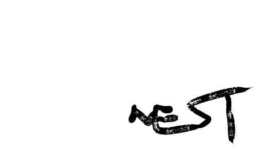

Nest combines legal move generation, alpha-beta search, a shared transposition
table, lazy SMP, and incremental NNUE evaluation. It is designed to be easy to
build locally and practical to use from any UCI-compatible chess GUI.

## Highlights

- UCI protocol support, including Chess960 and WDL output
- Incremental NNUE evaluation with Stockfish-compatible big and small networks
- Multi-threaded search with configurable hash size and thread count
- Architecture-aware builds for x86-64 and ARM, including Apple Silicon
- Built-in `bench`, `perft`, and `speedtest` commands

## Build

Nest has no library dependencies. You need a C++20 compiler and `make`.

```sh
make -j build
```

This creates the `nest` executable and selects compiler flags for the local
machine. To build a portable target, choose an architecture explicitly:

```sh
make -j build ARCH=x86-64-avx2
make -j build ARCH=apple-silicon
```

Run `make help` for the full target list. Use `COMP=clang` or `COMP=gcc` to
select a compiler, and `EXE=name` to choose a different executable name.

### NNUE networks

Download the default Stockfish networks before building if you want them
embedded in the executable:

```sh
make net
make -j build
```

Without embedded networks, Nest looks for the same `.nnue` files in its working
directory or alongside the executable. You can also set their paths from a UCI
GUI through `EvalFile` and `EvalFileSmall`.

## Use

Launch Nest from a UCI-compatible GUI, or interact with it directly:

```text
$ ./nest
uci
isready
position startpos moves e2e4 e7e5
go depth 12
quit
```

Useful commands outside a GUI:

```sh
./nest bench
./nest perft 6
./nest speedtest
```

The standard UCI options include `Hash`, `Threads`, `MultiPV`, `Ponder`,
`Move Overhead`, `UCI_Chess960`, `UCI_ShowWDL`, and `Clear Hash`.

## Development builds

```sh
make debug       # AddressSanitizer + UndefinedBehaviorSanitizer
make tsan        # ThreadSanitizer
make profile-build ARCH=native
```

`profile-build` trains profile-guided optimization using Nest's built-in bench.

## License and NNUE attribution

Nest is released under the [GNU GPL v3.0](LICENSE). Its default NNUE network
files are obtained from the [Stockfish networks repository](https://github.com/official-stockfish/networks)
and are GPL-3.0 licensed as well.
